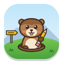

# Murmeli

[](https://github.com/samuelba/murmeli/actions/workflows/ci.yml)

<p align="center">
  
</p>

Murmeli is a self-hosted learning platform for kids from kindergarten to the end of 2nd class. It teaches **math, reading and writing**, follows the Swiss Lehrplan 21 (Zyklus 1), and is available in **German (de-CH)** and **American English**.

> Murmeli is aligned with Lehrplan 21 but not affiliated with it. "Murmeli" is a working name.

## Features
- **Levels:** kids climb an Alpine trail from the valley to the summit. Each level unlocks once the one before it is mastered. On the practice ground kids pick a topic (plus, minus, the clock, syllables …) or let Murmeli choose; the difficulty adapts and mistakes come back later.
- **Read-aloud:** every instruction can be read aloud, for kids who can't read yet. The audio is generated offline with open-weights TTS.
- **Family accounts:** a parent signs up and creates kid profiles with funny avatars. There are no photos, and kids don't need an email address or a password.
- **Admin:** user management, invites, and a switch to turn registration on or off.
- **Works everywhere:** a touch-friendly web app for phones, tablets and computers, with light and dark themes.
- **Security:** secure cookies, refresh token rotation, rate limits, optional TOTP, a strict CSP, and no third-party requests.

## Quick start (Docker)
```bash
cp .env.sample .env      # fill in the passwords, the secrets and APP_URL
docker compose up -d
```
Then open http://localhost:8080. The first visit walks you through creating the admin account.

## Documentation
The [user manual](docs/site/index.md) covers:
- [Quick start with Docker Compose](docs/site/getting-started/docker.md)
- [Reverse proxy and HTTPS](docs/site/deployment/reverse-proxy.md), [Security](docs/site/deployment/security.md), [Backups](docs/site/deployment/backups.md) and [Upgrades](docs/site/deployment/upgrades.md)
- Using it as a [parent](docs/site/usage/parents.md), [kid](docs/site/usage/kids.md) or [admin](docs/site/usage/admins.md)
- [Curriculum](docs/site/learning/curriculum.md), [narration audio](docs/site/learning/audio.md) and [privacy](docs/site/privacy.md)
- [Configuration reference](docs/site/reference/configuration.md)

[DEVELOPMENT.md](DEVELOPMENT.md) covers local development.
